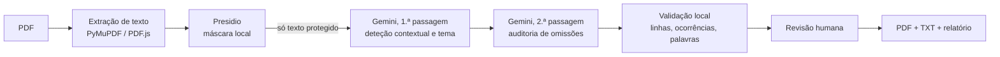

# Hidden — os teus documentos, sem os teus dados

Sistema de anonimização de documentos em português que combina deteção local (Microsoft Presidio) com raciocínio contextual (Google Gemini) e uma revisão humana interativa. Inclui um site local, uma extensão Chrome e uma linha de comandos.

Projeto da equipa **TheTrivials** para o desafio NOS "The \*-Files" do [JunctionX Lisbon 2026](tutorials/problem_and_eval.md), construído sobre o repositório-base do NOS Gen-AI Hackathon.

## Índice

- [O desafio](#o-desafio)
- [Funcionalidades](#funcionalidades)
- [Como funciona](#como-funciona)
- [Segurança e privacidade](#segurança-e-privacidade)
- [Começar](#começar)
- [Utilização](#utilização)
- [Estrutura do repositório](#estrutura-do-repositório)
- [Testes](#testes)
- [Entrega do hackathon](#entrega-do-hackathon)
- [Fluxo de trabalho no Git](#fluxo-de-trabalho-no-git)
- [Limitações](#limitações)
- [Bibliotecas open-source e créditos](#bibliotecas-open-source-e-créditos)
- [Equipa](#equipa)
- [Licença](#licença)

## O desafio

Identificar e mascarar dados pessoais ou sensíveis num documento, substituindo cada palavra por um `*` (`Ana Correia` → `* *`), mantendo o significado e a formatação originais, sem linhas vazias.

- Enunciado e critérios de avaliação: [tutorials/problem_and_eval.md](tutorials/problem_and_eval.md)
- Documento a anonimizar: [raw_data/document_to_anonymize.pdf](raw_data/document_to_anonymize.pdf)
- Regras de entrega: [submission/README.md](submission/README.md)

## Funcionalidades

**Site local.** Escolhes um ou vários PDFs, confirmas as categorias e recebes uma revisão interativa: o texto original com os fragmentos a ocultar destacados, um clique para manter ou ocultar, e seleção de texto para ocultar à mão. Exporta PDF, TXT e um relatório explicativo.

**Extensão Chrome.** Deteta quando abres um PDF e pergunta "Anonymize this document?". No fim oferece o download da versão mascarada ou a revisão no site, sem escolher ficheiros nem mudar de separador.

**Linha de comandos.** O mesmo motor, para processar um PDF diretamente e gerar os ficheiros de entrega.

**Relatório.** Cada deteção fica registada por linha, categoria, origem (`presidio` ou `llm`) e justificação, sem repetir os valores pessoais.

## Como funciona



1. **Presidio** (spaCy `pt_core_news_lg` e padrões próprios para NIF, NISS, Cartão de Cidadão, cartões, CVV, telefones +351 e identificadores profissionais) mascara localmente os dados de formato fixo.
2. **Gemini** recebe apenas esse texto já protegido. Um prompt estruturado (taxonomia RGPD, regras de máscara, exemplo, saída JSON, temperatura 0) deteta o que só o contexto revela: diagnósticos, medicação, estado civil, profissão, religião, dados genéticos e biométricos.
3. Uma **segunda passagem** procura omissões no texto já mascarado.
4. A **validação local** localiza cada entidade por linha e ocorrência e exige que a resposta mantenha as linhas e palavras do original. Uma resposta inválida tem uma tentativa de correção; se voltar a falhar, nada é publicado.
5. O **contexto automático** infere o tema do documento e preserva informação geral, educativa e administrativa (rótulos, instituições, datas do relatório) sem libertar identificadores.

O modelo predefinido da deteção é `gemini-3.5-flash-lite` (a entrega `submission.txt` mantém `gemini-3.1-flash-lite`); a variável `GEMINI_MODEL` escolhe outro para ambos. Detalhes em [APP.md](APP.md), [API.md](API.md) e [submission/USAGE.md](submission/USAGE.md).

## Segurança e privacidade

- O site e a extensão comunicam apenas com o serviço local em `127.0.0.1`. Não há contas nem base de dados; as sessões vivem em memória e expiram ao fim de uma hora.
- O Presidio protege todas as suas deteções antes de qualquer chamada ao Gemini. O PDF original nunca é enviado ao Gemini.
- O prompt trata o documento como conteúdo e ignora instruções escritas nele.
- A API valida `Host` e `Origin` (só a própria origem e o identificador fixo da extensão), usa identificadores de sessão imprevisíveis, limita o tamanho dos pedidos e não devolve o conteúdo do documento nas mensagens de erro.
- A chave Gemini fica em `submission/.env`, ignorado pelo Git. Não está no frontend nem na extensão.
- O PDF exportado é composto de raiz: não transporta metadados, imagens, anexos nem anotações do original.

## Começar

### Pré-requisitos

- Python 3.9 ou superior (recomendado 3.11 ou 3.12)
- Node.js 22.12 ou superior com npm ou pnpm, apenas para compilar a interface na primeira vez
- Chrome 127 ou superior, para a extensão
- Uma chave da Gemini API, criada no [Google AI Studio](https://aistudio.google.com/) (ver [tutorials/gemini_tutorial.md](tutorials/gemini_tutorial.md))

### Instalação

```bash
git clone https://github.com/Cristiano-Suranyi/team-TheTrivials.git
cd team-TheTrivials
```

Cria o ficheiro `submission/.env` com a tua chave:

```
GEMINI_API_KEY=a-tua-chave
```

Arranca o serviço (no Windows, `py run_app.py`):

```bash
python3 run_app.py
```

O primeiro arranque cria o ambiente virtual em `submission/venv`, instala as dependências e o modelo português e compila a interface. É necessária ligação à Internet. Depois abre <http://127.0.0.1:8787>.

| Comando | O que faz |
|---|---|
| `python3 run_app.py --setup` | Instala, compila e termina |
| `python3 run_app.py --build` | Recompila a interface e arranca |
| `python3 run_app.py --port 8788` | Usa outra porta |

## Utilização

### Site

1. Escolhe ou arrasta um ou vários PDFs com texto selecionável (até 20 MB cada).
2. Confirma as categorias e inicia a anonimização.
3. Revê as sugestões: clica para manter ou ocultar, ou seleciona texto para o ocultar manualmente.
4. Descarrega o PDF. O TXT e o relatório ficam numa pasta própria em `output/`.

### Extensão Chrome

1. Abre `chrome://extensions`, ativa o **Modo de programador** e escolhe **Carregar sem compactação**. Seleciona a pasta [extension/](extension).
2. Para PDFs locais, ativa **Permitir acesso a URLs de ficheiros** nos detalhes da extensão.
3. Com o serviço local a correr, abre um PDF e responde **Yes**.

No macOS, [scripts/install_autostart.command](scripts/install_autostart.command) mantém o serviço ligado no início de sessão. Instruções completas em [extension/README.md](extension/README.md).

### Linha de comandos

```bash
python3 submission/main.py                                   # documento do desafio
python3 submission/main.py --pdf "documento.pdf" --saida "resultado.txt"
python3 submission/main.py --review                          # validação manual no terminal
python3 submission/anonymize.py                              # pipeline de uma só chamada
```

Todas as opções em [submission/USAGE.md](submission/USAGE.md).

## Estrutura do repositório

```
.
├── submission/              Motor de anonimização e ficheiros de entrega
│   ├── main.py              Extração, Presidio, Gemini, máscara e relatório
│   ├── anonymize.py         Pipeline alternativo de uma só chamada
│   ├── web_api.py           API local FastAPI (sessões, revisão, exportação)
│   ├── pdf_export.py        Composição do PDF anonimizado
│   ├── prompt_template.txt  Template do prompt
│   ├── prompt.txt           Prompt exato da entrega
│   ├── submission.txt       Saída avaliada
│   └── requirements.txt     Dependências Python
├── frontend/                Interface React (revisão interativa)
├── extension/               Extensão Chrome (Manifest V3)
├── extension-tests/         Testes da extensão
├── tests/                   Testes Python (motor, API, exportação)
├── scripts/                 Arranque automático (macOS) e teste ponta a ponta
├── raw_data/                Documento a anonimizar
├── output/                  TXT e relatórios gerados
├── tutorials/               Enunciado e tutoriais do hackathon
├── run_app.py               Arranca o site e a API
├── APP.md, API.md           Documentação da aplicação e do contrato da API
└── LICENSE
```

## Testes

```bash
submission/venv/bin/python -m unittest discover -s tests -v   # motor, API e exportação PDF
node --test extension-tests/*.test.js                          # extensão
cd frontend && pnpm install --frozen-lockfile && pnpm test     # interface
```

No Windows, usa `submission\venv\Scripts\python.exe`. Também podes usar `npm install` e `npm test` no frontend.

## Entrega do hackathon

Os ficheiros avaliados automaticamente em cada pull request para `main` são:

- [submission/submission.txt](submission/submission.txt): apenas a saída devolvida pelo modelo.
- [submission/prompt.txt](submission/prompt.txt): o prompt exato que a gerou.

Cada análise concluída no site substitui estes dois ficheiros. Antes de fazer commit da entrega, analisa por último `raw_data/document_to_anonymize.pdf` e confirma que `submission.txt` começa por `Relatório de Admissão - Centro Médico Lisboa`.

## Fluxo de trabalho no Git

- Cada membro trabalha no seu próprio ramo (`andre`, `ines`, `pedro`, `suranyi`). Não há commits diretos em `main`.
- A integração faz-se por merge entre ramos e por pull request para `main`, que corre a avaliação automática.
- Mensagens de commit curtas e descritivas, com o tipo como prefixo: `feat:`, `fix:`, `docs:`, `test:`.
- Cada push corre o `flake8` ([.github/workflows/lint.yml](.github/workflows/lint.yml)). Corre os testes antes de abrir o pull request.
- Chaves, ficheiros `.env`, ambientes virtuais e `node_modules` nunca entram no repositório. Se uma chave for exposta, revoga-a de imediato no Google AI Studio.
- Não se faz commit de documentos com dados pessoais reais.

Se o Git for novidade, vê [tutorials/git_tutorial.md](tutorials/git_tutorial.md).

## Limitações

- PDFs digitalizados sem camada de texto precisam de OCR, que não está incluído.
- Limites: 20 MB por PDF, 5 000 linhas e 200 000 caracteres por documento. Não há truncamento silencioso.
- O PDF exportado é um documento novo: o desenho e o número de páginas podem diferir do original.
- O Gemini recebe o contexto que o Presidio não reconheceu localmente. Para dados reais, revê sempre as deteções.
- Nenhum detetor garante encontrar todos os dados sensíveis: a revisão humana faz parte do processo.

## Bibliotecas open-source e créditos

| Componente | Utilização | Licença |
|---|---|---|
| [Microsoft Presidio](https://github.com/microsoft/presidio) | Deteção local de dados pessoais | MIT |
| [spaCy](https://spacy.io/) | Processamento de linguagem natural | MIT |
| [pt_core_news_lg](https://spacy.io/models/pt) | Modelo de português para o spaCy | CC BY-SA 4.0 |
| [PyMuPDF](https://github.com/pymupdf/PyMuPDF) | Extração de texto e composição de PDF | AGPL-3.0 ou comercial |
| [Google Gen AI SDK](https://github.com/googleapis/python-genai) | Chamadas à Gemini API | Apache-2.0 |
| [FastAPI](https://fastapi.tiangolo.com/) | API local | MIT |
| [Uvicorn](https://www.uvicorn.org/) | Servidor ASGI | BSD-3-Clause |
| [HTTPX](https://www.python-httpx.org/) | Cliente HTTP | BSD-3-Clause |
| [python-multipart](https://github.com/Kludex/python-multipart) | Upload de ficheiros | Apache-2.0 |
| [React](https://react.dev/) | Interface | MIT |
| [Vite](https://vite.dev/) e [Vitest](https://vitest.dev/) | Compilação e testes do frontend | MIT |
| [TanStack Router e Query](https://tanstack.com/) | Rotas e estado de dados | MIT |
| [Tailwind CSS](https://tailwindcss.com/) | Estilos | MIT |
| [Radix UI](https://www.radix-ui.com/) | Componentes acessíveis | MIT |
| [Lucide](https://lucide.dev/) | Ícones | ISC |
| [PDF.js](https://mozilla.github.io/pdf.js/) | Leitura de PDF no navegador | Apache-2.0 |
| [Zod](https://zod.dev/) | Validação de dados | MIT |
| [TypeScript](https://www.typescriptlang.org/) | Linguagem do frontend | Apache-2.0 |

As dependências são instaladas a partir dos respetivos registos (`submission/requirements.txt` e `frontend/package.json`) e não são redistribuídas neste repositório. O modelo de linguagem é o Google Gemini, usado através da Gemini API e sujeito aos termos da Google.

O repositório-base, os tutoriais e os workflows de avaliação são da [NOS](https://github.com/nosportugal).

## Equipa

**TheTrivials**: André Felizardo, Cristiano Suranyi, Inês e Pedro.

## Licença

Distribuído sob a licença MIT. Consulta o ficheiro [LICENSE](LICENSE), que mantém o aviso de direitos de autor do repositório-base.
